# provider-file-transfer-v2: legacy architecture

The legacy module as the code graph sees it: projects, references, packages, entry points, data, outside calls, and where the graph loses the trail. Written by the tool, not by AI. Per-flow detail is in each flow's `TECH.md`.

## Projects

| Project | Folder | Targets | Module types | Doors |
| --- | --- | --- | ---: | --- |
| `HP.HSP.UA3.FileTransfer.BAS.FileTransferSvc` | `bas/FileTransferSvc/HP.HSP.UA3.FileTransfer.BAS.FileTransferSvc` | v4.8 | 7 | 15 wcf |
| `HP.HSP.UA3.FileTransfer.BAS.FileTransferSvc.Batch.Business` | `bas/FileTransferSvc/HP.HSP.UA3.FileTransfer.BAS.FileTransferSvc.Batch.Business` | v4.8 | 39 | - |
| `HP.HSP.UA3.FileTransfer.BAS.FileTransferSvc.Batch.BusinessTests` | `bas/FileTransferSvc/HP.HSP.UA3.FileTransfer.BAS.FileTransferSvc.Batch.BusinessTests` | v4.8 | 5 | - |
| `HP.HSP.UA3.FileTransfer.BAS.FileTransferSvc.Batch.Main` | `bas/FileTransferSvc/HP.HSP.UA3.FileTransfer.BAS.FileTransferSvc.Batch.Main` | v4.8 | 1 | 1 batch |
| `HP.HSP.UA3.FileTransfer.BAS.FileTransferSvc.Batch.Main.Tests` | `bas/FileTransferSvc/HP.HSP.UA3.FileTransfer.BAS.FileTransferSvc.Batch.Main.Tests` | v4.8 | 1 | - |
| `HP.HSP.UA3.FileTransfer.BAS.FileTransferSvc.Business` | `bas/FileTransferSvc/HP.HSP.UA3.FileTransfer.BAS.FileTransferSvc.Business` | v4.8 | 10 | - |
| `HP.HSP.UA3.FileTransfer.BAS.FileTransferSvc.Business.Tests` | `bas/FileTransferSvc/HP.HSP.UA3.FileTransfer.BAS.FileTransferSvc.Business.Tests` | v4.8 | 5 | - |
| `HP.HSP.UA3.FileTransfer.BAS.FileTransferSvc.Contracts` | `bas/FileTransferSvc/HP.HSP.UA3.FileTransfer.BAS.FileTransferSvc.Contracts` | v4.8 | 84 | - |
| `HP.HSP.UA3.FileTransfer.BAS.FileTransferSvc.Contracts.Tests` | `bas/FileTransferSvc/HP.HSP.UA3.FileTransfer.BAS.FileTransferSvc.Contracts.Tests` | v4.8 | 21 | - |
| `HP.HSP.UA3.FileTransfer.BAS.FileTransferSvc.DataAccess` | `bas/FileTransferSvc/HP.HSP.UA3.FileTransfer.BAS.FileTransferSvc.DataAccess` | v4.8 | 45 | - |
| `HP.HSP.UA3.FileTransfer.BAS.FileTransferSvc.DataAccess.Tests` | `bas/FileTransferSvc/HP.HSP.UA3.FileTransfer.BAS.FileTransferSvc.DataAccess.Tests` | v4.8 | 23 | - |
| `HP.HSP.UA3.FileTransfer.BAS.FileTransferSvc.Tests` | `bas/FileTransferSvc/HP.HSP.UA3.FileTransfer.BAS.FileTransferSvc.Tests` | v4.8 | 2 | - |
| `HP.HSP.UA3.FileTransfer.UX.Data` | `ux/HP.HSP.UA3.FileTransfer.UX.Data` | v4.8 | 46 | - |
| `HP.HSP.UA3.FileTransfer.UX.Data.Tests` | `ux/HP.HSP.UA3.FileTransfer.UX.Data.Tests` | v4.8 | 11 | - |
| `HP.HSP.UA3.FileTransfer.UX.Presentation` | `ux/HP.HSP.UA3.FileTransfer.UX.Presentation` | v4.8 | 1 | 6 api |
| `HP.HSP.UA3.FileTransfer.UX.Presentation.Tests` | `ux/HP.HSP.UA3.FileTransfer.UX.Presentation.Tests` | v4.8 | 1 | - |
| `HP.HSP.UA3.FileTransfer.UX.Providers` | `ux/HP.HSP.UA3.FileTransfer.UX.Providers` | v4.8 | 83 | - |
| `HP.HSP.UA3.FileTransfer.UX.Providers.Tests` | `ux/HP.HSP.UA3.FileTransfer.UX.Providers.Tests` | v4.8 | 2 | - |
| `HP.HSP.UA3.FileTransfer.UX.Services` | `ux/HP.HSP.UA3.FileTransfer.UX.Services` | v4.8 | 2 | 12 api |
| `HP.HSP.UA3.FileTransfer.UX.Services.Tests` | `ux/HP.HSP.UA3.FileTransfer.UX.Services.Tests` | v4.8 | 2 | - |
| `HPE.HSP.UA3.FT.Batch.FileTransferMgmt.Business` | `batch/FileTransferManagement/HPE.HSP.UA3.FT.Batch.FileTransferMgmt.Business` | v4.8 | 46 | - |
| `HPE.HSP.UA3.FT.Batch.FileTransferMgmt.Business.Tests` | `batch/FileTransferManagement/HPE.HSP.UA3.FT.Batch.FileTransferMgmt.Business.Tests` | v4.8 | 7 | - |
| `HPE.HSP.UA3.FT.Batch.FileTransferMgmt.Contracts` | `batch/FileTransferManagement/HPE.HSP.UA3.FT.Batch.FileTransferMgmt.Contracts` | v4.8 | 21 | - |
| `HPE.HSP.UA3.FT.Batch.FileTransferMgmt.Contracts.Tests` | `batch/FileTransferManagement/HPE.HSP.UA3.FT.Batch.FileTransferMgmt.Contracts.Tests` | v4.8 | 15 | - |
| `HPE.HSP.UA3.FT.Batch.FileTransferMgmt.Ctrl` | `batch/FileTransferManagement/HPE.HSP.UA3.FT.Batch.FileTransferMgmt.Ctrl` | v4.8 | 4 | - |
| `HPE.HSP.UA3.FT.Batch.FileTransferMgmt.DataAccess` | `batch/FileTransferManagement/HPE.HSP.UA3.FT.Batch.FileTransferMgmt.DataAccess` | v4.8 | 30 | - |
| `HPE.HSP.UA3.FT.Batch.FileTransferMgmt.DataAccess.Tests` | `batch/FileTransferManagement/HPE.HSP.UA3.FT.Batch.FileTransferMgmt.DataAccess.Tests` | v4.8 | 14 | - |
| `HPE.HSP.UA3.FT.Batch.FileTransferMgmt.Main` | `batch/FileTransferManagement/HPE.HSP.UA3.FT.Batch.FileTransferMgmt.Main` | v4.8 | 1 | 1 batch |
| `HPE.HSP.UA3.FT.Batch.FileTransferMgmt.Main.Tests` | `batch/FileTransferManagement/HPE.HSP.UA3.FT.Batch.FileTransferMgmt.Main.Tests` | v4.8 | 1 | - |
| `HPP.FileTransfer.BAS.FileTransferApi` | `bas/FileTransferSvc/HPP.FileTransfer.BAS.FileTransferApi` | net10.0 | 11 | 11 api, 1 batch, 13 wcf |
| `HPP.FileTransfer.BAS.FileTransferSvc` | `bas/FileTransferSvc/HPP.FileTransfer.BAS.FileTransferSvcCore` | net10.0 | 8 | 1 batch, 15 wcf |
| `HPP.FileTransfer.BAS.FileTransferSvc.Business` | `bas/FileTransferSvc/HPP.FileTransfer.BAS.FileTransferSvc.Business` | net10.0 | 14 | - |
| `HPP.FileTransfer.BAS.FileTransferSvc.Business.Tests` | `bas/FileTransferSvc/HPP.FileTransfer.BAS.FileTransferSvc.Business.Tests` | net10.0 | 5 | - |
| `HPP.FileTransfer.BAS.FileTransferSvc.Contracts` | `bas/FileTransferSvc/HPP.FileTransfer.BAS.FileTransferSvc.Contracts` | net10.0 | 79 | - |
| `HPP.FileTransfer.BAS.FileTransferSvc.Contracts.Tests` | `bas/FileTransferSvc/HPP.FileTransfer.BAS.FileTransferSvc.Contracts.Tests` | net10.0 | 19 | - |
| `HPP.FileTransfer.BAS.FileTransferSvc.DataAccess` | `bas/FileTransferSvc/HPP.FileTransfer.BAS.FileTransferSvc.DataAccess` | net10.0 | 45 | - |
| `HPP.FileTransfer.BAS.FileTransferSvc.DataAccess.Tests` | `bas/FileTransferSvc/HPP.FileTransfer.BAS.FileTransferSvc.DataAccess.Tests` | net10.0 | 23 | - |
| `HPP.FileTransfer.BAS.FileTransferSvc.Main` | `bas/FileTransferSvc/HPP.FileTransfer.BAS.FileTransferSvc.Main` | v4.8 | 5 | 1 batch |
| `HPP.FileTransfer.BAS.FileTransferSvc.Tests` | `bas/FileTransferSvc/HPP.FileTransfer.BAS.FileTransferSvc.Tests` | net10.0 | 2 | - |

## How the projects reference each other

```mermaid
graph TD
  HP_HSP_UA3_FileTransfer_BAS_FileTransferSvc_Batch_BusinessTests --> HP_HSP_UA3_FileTransfer_BAS_FileTransferSvc_DataAccess
  HP_HSP_UA3_FileTransfer_BAS_FileTransferSvc_Batch_BusinessTests --> HP_HSP_UA3_FileTransfer_BAS_FileTransferSvc_Batch_Business
  HP_HSP_UA3_FileTransfer_BAS_FileTransferSvc_Batch_BusinessTests --> HP_HSP_UA3_FileTransfer_BAS_FileTransferSvc_Contracts
  HP_HSP_UA3_FileTransfer_BAS_FileTransferSvc_Batch_Business --> HP_HSP_UA3_FileTransfer_BAS_FileTransferSvc_Contracts
  HP_HSP_UA3_FileTransfer_BAS_FileTransferSvc_Batch_Business --> HP_HSP_UA3_FileTransfer_BAS_FileTransferSvc_DataAccess
  HP_HSP_UA3_FileTransfer_BAS_FileTransferSvc_Batch_Main_Tests --> HP_HSP_UA3_FileTransfer_BAS_FileTransferSvc_Batch_Main
  HP_HSP_UA3_FileTransfer_BAS_FileTransferSvc_Batch_Main --> HP_HSP_UA3_FileTransfer_BAS_FileTransferSvc_Batch_Business
  HP_HSP_UA3_FileTransfer_BAS_FileTransferSvc_Business_Tests --> HP_HSP_UA3_FileTransfer_BAS_FileTransferSvc_Contracts
  HP_HSP_UA3_FileTransfer_BAS_FileTransferSvc_Business_Tests --> HP_HSP_UA3_FileTransfer_BAS_FileTransferSvc_Business
  HP_HSP_UA3_FileTransfer_BAS_FileTransferSvc_Business_Tests --> HP_HSP_UA3_FileTransfer_BAS_FileTransferSvc_DataAccess_Tests
  HP_HSP_UA3_FileTransfer_BAS_FileTransferSvc_Business_Tests --> HP_HSP_UA3_FileTransfer_BAS_FileTransferSvc_DataAccess
  HP_HSP_UA3_FileTransfer_BAS_FileTransferSvc_Business --> HP_HSP_UA3_FileTransfer_BAS_FileTransferSvc_DataAccess
  HP_HSP_UA3_FileTransfer_BAS_FileTransferSvc_Business --> HP_HSP_UA3_FileTransfer_BAS_FileTransferSvc_Contracts
  HP_HSP_UA3_FileTransfer_BAS_FileTransferSvc_Contracts_Tests --> HP_HSP_UA3_FileTransfer_BAS_FileTransferSvc_Contracts
  HP_HSP_UA3_FileTransfer_BAS_FileTransferSvc_DataAccess_Tests --> HP_HSP_UA3_FileTransfer_BAS_FileTransferSvc_Contracts
  HP_HSP_UA3_FileTransfer_BAS_FileTransferSvc_DataAccess_Tests --> HP_HSP_UA3_FileTransfer_BAS_FileTransferSvc_DataAccess
  HP_HSP_UA3_FileTransfer_BAS_FileTransferSvc_DataAccess --> HP_HSP_UA3_FileTransfer_BAS_FileTransferSvc_Contracts
  HP_HSP_UA3_FileTransfer_BAS_FileTransferSvc_Tests --> HP_HSP_UA3_FileTransfer_BAS_FileTransferSvc_Contracts
  HP_HSP_UA3_FileTransfer_BAS_FileTransferSvc_Tests --> HP_HSP_UA3_FileTransfer_BAS_FileTransferSvc
  HP_HSP_UA3_FileTransfer_BAS_FileTransferSvc_Tests --> HP_HSP_UA3_FileTransfer_BAS_FileTransferSvc_Business
  HP_HSP_UA3_FileTransfer_BAS_FileTransferSvc --> HP_HSP_UA3_FileTransfer_BAS_FileTransferSvc_Batch_Business
  HP_HSP_UA3_FileTransfer_BAS_FileTransferSvc --> HP_HSP_UA3_FileTransfer_BAS_FileTransferSvc_Business
  HP_HSP_UA3_FileTransfer_BAS_FileTransferSvc --> HP_HSP_UA3_FileTransfer_BAS_FileTransferSvc_Contracts
  HP_HSP_UA3_FileTransfer_BAS_FileTransferSvc --> HP_HSP_UA3_FileTransfer_BAS_FileTransferSvc_DataAccess
  HPP_FileTransfer_BAS_FileTransferApi --> HPP_FileTransfer_BAS_FileTransferSvc_Contracts
  HPP_FileTransfer_BAS_FileTransferApi --> HPP_FileTransfer_BAS_FileTransferSvc_Business
  HPP_FileTransfer_BAS_FileTransferApi --> HPP_FileTransfer_BAS_FileTransferSvc_DataAccess
  HPP_FileTransfer_BAS_FileTransferSvc_Business_Tests --> HPP_FileTransfer_BAS_FileTransferSvc_Contracts
  HPP_FileTransfer_BAS_FileTransferSvc_Business_Tests --> HPP_FileTransfer_BAS_FileTransferSvc_DataAccess_Tests
  HPP_FileTransfer_BAS_FileTransferSvc_Business_Tests --> HPP_FileTransfer_BAS_FileTransferSvc_Business
  HPP_FileTransfer_BAS_FileTransferSvc_Business_Tests --> HPP_FileTransfer_BAS_FileTransferSvc_DataAccess
  HPP_FileTransfer_BAS_FileTransferSvc_Business --> HPP_FileTransfer_BAS_FileTransferSvc_Contracts
  HPP_FileTransfer_BAS_FileTransferSvc_Business --> HPP_FileTransfer_BAS_FileTransferSvc_DataAccess
  HPP_FileTransfer_BAS_FileTransferSvc_Contracts_Tests --> HPP_FileTransfer_BAS_FileTransferSvc_Contracts
  HPP_FileTransfer_BAS_FileTransferSvc_DataAccess_Tests --> HPP_FileTransfer_BAS_FileTransferSvc_DataAccess
  HPP_FileTransfer_BAS_FileTransferSvc_DataAccess_Tests --> HPP_FileTransfer_BAS_FileTransferSvc_Contracts
  HPP_FileTransfer_BAS_FileTransferSvc_DataAccess_Tests --> HPP_FileTransfer_BAS_FileTransferSvc_Business
  HPP_FileTransfer_BAS_FileTransferSvc_DataAccess --> HPP_FileTransfer_BAS_FileTransferSvc_Contracts
  HPP_FileTransfer_BAS_FileTransferSvc_Main --> HP_HSP_UA3_FileTransfer_BAS_FileTransferSvc_Contracts
  HPP_FileTransfer_BAS_FileTransferSvc_Main --> HP_HSP_UA3_FileTransfer_BAS_FileTransferSvc
  HPP_FileTransfer_BAS_FileTransferSvc_Main --> HP_HSP_UA3_FileTransfer_BAS_FileTransferSvc_Business
  HPP_FileTransfer_BAS_FileTransferSvc_Main --> HP_HSP_UA3_FileTransfer_BAS_FileTransferSvc_DataAccess
  HPP_FileTransfer_BAS_FileTransferSvc_Main --> HP_HSP_UA3_FileTransfer_BAS_FileTransferSvc_Batch_Business
  HPP_FileTransfer_BAS_FileTransferSvc_Tests --> HPP_FileTransfer_BAS_FileTransferSvc_Contracts
  HPP_FileTransfer_BAS_FileTransferSvc_Tests --> HPP_FileTransfer_BAS_FileTransferSvc
  HPP_FileTransfer_BAS_FileTransferSvc_Tests --> HPP_FileTransfer_BAS_FileTransferSvc_DataAccess
  HPP_FileTransfer_BAS_FileTransferSvc_Tests --> HPP_FileTransfer_BAS_FileTransferSvc_Business
  HPP_FileTransfer_BAS_FileTransferSvc --> HPP_FileTransfer_BAS_FileTransferSvc_Contracts
  HPP_FileTransfer_BAS_FileTransferSvc --> HPP_FileTransfer_BAS_FileTransferSvc_Business
  HPP_FileTransfer_BAS_FileTransferSvc --> HPP_FileTransfer_BAS_FileTransferSvc_DataAccess
  HPE_HSP_UA3_FT_Batch_FileTransferMgmt_Business_Tests --> HP_HSP_UA3_FileTransfer_BAS_FileTransferSvc_Batch_Business
  HPE_HSP_UA3_FT_Batch_FileTransferMgmt_Business_Tests --> HP_HSP_UA3_FileTransfer_BAS_FileTransferSvc_DataAccess
  HPE_HSP_UA3_FT_Batch_FileTransferMgmt_Business_Tests --> HP_HSP_UA3_FileTransfer_BAS_FileTransferSvc_Contracts
  HPE_HSP_UA3_FT_Batch_FileTransferMgmt_Business_Tests --> HPE_HSP_UA3_FT_Batch_FileTransferMgmt_DataAccess
  HPE_HSP_UA3_FT_Batch_FileTransferMgmt_Business_Tests --> HPE_HSP_UA3_FT_Batch_FileTransferMgmt_Ctrl
  HPE_HSP_UA3_FT_Batch_FileTransferMgmt_Business_Tests --> HP_HSP_UA3_FileTransfer_BAS_FileTransferSvc_Business
  HPE_HSP_UA3_FT_Batch_FileTransferMgmt_Business_Tests --> HPE_HSP_UA3_FT_Batch_FileTransferMgmt_Contracts
  HPE_HSP_UA3_FT_Batch_FileTransferMgmt_Business_Tests --> HPE_HSP_UA3_FT_Batch_FileTransferMgmt_Business
  HPE_HSP_UA3_FT_Batch_FileTransferMgmt_Business_Tests --> HP_HSP_UA3_FileTransfer_BAS_FileTransferSvc
  HPE_HSP_UA3_FT_Batch_FileTransferMgmt_Business --> HPE_HSP_UA3_FT_Batch_FileTransferMgmt_Contracts
  HPE_HSP_UA3_FT_Batch_FileTransferMgmt_Business --> HP_HSP_UA3_FileTransfer_BAS_FileTransferSvc
  HPE_HSP_UA3_FT_Batch_FileTransferMgmt_Business --> HPE_HSP_UA3_FT_Batch_FileTransferMgmt_Ctrl
  HPE_HSP_UA3_FT_Batch_FileTransferMgmt_Business --> HP_HSP_UA3_FileTransfer_BAS_FileTransferSvc_Contracts
  HPE_HSP_UA3_FT_Batch_FileTransferMgmt_Business --> HP_HSP_UA3_FileTransfer_BAS_FileTransferSvc_DataAccess
  HPE_HSP_UA3_FT_Batch_FileTransferMgmt_Business --> HPE_HSP_UA3_FT_Batch_FileTransferMgmt_DataAccess
  HPE_HSP_UA3_FT_Batch_FileTransferMgmt_Business --> HP_HSP_UA3_FileTransfer_BAS_FileTransferSvc_Batch_Business
  HPE_HSP_UA3_FT_Batch_FileTransferMgmt_Business --> HP_HSP_UA3_FileTransfer_BAS_FileTransferSvc_Business
  HPE_HSP_UA3_FT_Batch_FileTransferMgmt_Contracts_Tests --> HP_HSP_UA3_FileTransfer_BAS_FileTransferSvc_Business
  HPE_HSP_UA3_FT_Batch_FileTransferMgmt_Contracts_Tests --> HP_HSP_UA3_FileTransfer_BAS_FileTransferSvc_Contracts
  HPE_HSP_UA3_FT_Batch_FileTransferMgmt_Contracts_Tests --> HP_HSP_UA3_FileTransfer_BAS_FileTransferSvc_Batch_Business
  HPE_HSP_UA3_FT_Batch_FileTransferMgmt_Contracts_Tests --> HP_HSP_UA3_FileTransfer_BAS_FileTransferSvc_DataAccess
  HPE_HSP_UA3_FT_Batch_FileTransferMgmt_Contracts_Tests --> HP_HSP_UA3_FileTransfer_BAS_FileTransferSvc
  HPE_HSP_UA3_FT_Batch_FileTransferMgmt_Contracts_Tests --> HPE_HSP_UA3_FT_Batch_FileTransferMgmt_Contracts
  HPE_HSP_UA3_FT_Batch_FileTransferMgmt_Contracts --> HP_HSP_UA3_FileTransfer_BAS_FileTransferSvc
  HPE_HSP_UA3_FT_Batch_FileTransferMgmt_Contracts --> HP_HSP_UA3_FileTransfer_BAS_FileTransferSvc_Contracts
  HPE_HSP_UA3_FT_Batch_FileTransferMgmt_Contracts --> HP_HSP_UA3_FileTransfer_BAS_FileTransferSvc_Batch_Business
  HPE_HSP_UA3_FT_Batch_FileTransferMgmt_Contracts --> HP_HSP_UA3_FileTransfer_BAS_FileTransferSvc_Business
  HPE_HSP_UA3_FT_Batch_FileTransferMgmt_Contracts --> HP_HSP_UA3_FileTransfer_BAS_FileTransferSvc_DataAccess
  HPE_HSP_UA3_FT_Batch_FileTransferMgmt_Ctrl --> HP_HSP_UA3_FileTransfer_BAS_FileTransferSvc_Contracts
  HPE_HSP_UA3_FT_Batch_FileTransferMgmt_Ctrl --> HP_HSP_UA3_FileTransfer_BAS_FileTransferSvc_Business
  HPE_HSP_UA3_FT_Batch_FileTransferMgmt_Ctrl --> HP_HSP_UA3_FileTransfer_BAS_FileTransferSvc_Batch_Business
  HPE_HSP_UA3_FT_Batch_FileTransferMgmt_Ctrl --> HP_HSP_UA3_FileTransfer_BAS_FileTransferSvc
  HPE_HSP_UA3_FT_Batch_FileTransferMgmt_Ctrl --> HP_HSP_UA3_FileTransfer_BAS_FileTransferSvc_DataAccess
  HPE_HSP_UA3_FT_Batch_FileTransferMgmt_DataAccess_Tests --> HP_HSP_UA3_FileTransfer_BAS_FileTransferSvc_Batch_Business
  HPE_HSP_UA3_FT_Batch_FileTransferMgmt_DataAccess_Tests --> HP_HSP_UA3_FileTransfer_BAS_FileTransferSvc_Business
  HPE_HSP_UA3_FT_Batch_FileTransferMgmt_DataAccess_Tests --> HP_HSP_UA3_FileTransfer_BAS_FileTransferSvc_DataAccess
  HPE_HSP_UA3_FT_Batch_FileTransferMgmt_DataAccess_Tests --> HPE_HSP_UA3_FT_Batch_FileTransferMgmt_Contracts
  HPE_HSP_UA3_FT_Batch_FileTransferMgmt_DataAccess_Tests --> HPE_HSP_UA3_FT_Batch_FileTransferMgmt_DataAccess
  HPE_HSP_UA3_FT_Batch_FileTransferMgmt_DataAccess_Tests --> HP_HSP_UA3_FileTransfer_BAS_FileTransferSvc
  HPE_HSP_UA3_FT_Batch_FileTransferMgmt_DataAccess_Tests --> HP_HSP_UA3_FileTransfer_BAS_FileTransferSvc_Contracts
  HPE_HSP_UA3_FT_Batch_FileTransferMgmt_DataAccess --> HP_HSP_UA3_FileTransfer_BAS_FileTransferSvc_Business
  HPE_HSP_UA3_FT_Batch_FileTransferMgmt_DataAccess --> HP_HSP_UA3_FileTransfer_BAS_FileTransferSvc_Contracts
  HPE_HSP_UA3_FT_Batch_FileTransferMgmt_DataAccess --> HP_HSP_UA3_FileTransfer_BAS_FileTransferSvc
  HPE_HSP_UA3_FT_Batch_FileTransferMgmt_DataAccess --> HP_HSP_UA3_FileTransfer_BAS_FileTransferSvc_DataAccess
  HPE_HSP_UA3_FT_Batch_FileTransferMgmt_DataAccess --> HPE_HSP_UA3_FT_Batch_FileTransferMgmt_Contracts
  HPE_HSP_UA3_FT_Batch_FileTransferMgmt_DataAccess --> HP_HSP_UA3_FileTransfer_BAS_FileTransferSvc_Batch_Business
  HPE_HSP_UA3_FT_Batch_FileTransferMgmt_Main_Tests --> HP_HSP_UA3_FileTransfer_BAS_FileTransferSvc_Batch_Business
  HPE_HSP_UA3_FT_Batch_FileTransferMgmt_Main_Tests --> HPE_HSP_UA3_FT_Batch_FileTransferMgmt_Contracts
  HPE_HSP_UA3_FT_Batch_FileTransferMgmt_Main_Tests --> HPE_HSP_UA3_FT_Batch_FileTransferMgmt_Ctrl
  HPE_HSP_UA3_FT_Batch_FileTransferMgmt_Main_Tests --> HP_HSP_UA3_FileTransfer_BAS_FileTransferSvc_DataAccess
  HPE_HSP_UA3_FT_Batch_FileTransferMgmt_Main_Tests --> HPE_HSP_UA3_FT_Batch_FileTransferMgmt_Main
  HPE_HSP_UA3_FT_Batch_FileTransferMgmt_Main_Tests --> HPE_HSP_UA3_FT_Batch_FileTransferMgmt_DataAccess
  HPE_HSP_UA3_FT_Batch_FileTransferMgmt_Main_Tests --> HP_HSP_UA3_FileTransfer_BAS_FileTransferSvc_Business
  HPE_HSP_UA3_FT_Batch_FileTransferMgmt_Main_Tests --> HP_HSP_UA3_FileTransfer_BAS_FileTransferSvc_Contracts
  HPE_HSP_UA3_FT_Batch_FileTransferMgmt_Main_Tests --> HPE_HSP_UA3_FT_Batch_FileTransferMgmt_Business
  HPE_HSP_UA3_FT_Batch_FileTransferMgmt_Main_Tests --> HP_HSP_UA3_FileTransfer_BAS_FileTransferSvc
  HPE_HSP_UA3_FT_Batch_FileTransferMgmt_Main --> HPE_HSP_UA3_FT_Batch_FileTransferMgmt_DataAccess
  HPE_HSP_UA3_FT_Batch_FileTransferMgmt_Main --> HPE_HSP_UA3_FT_Batch_FileTransferMgmt_Ctrl
  HPE_HSP_UA3_FT_Batch_FileTransferMgmt_Main --> HPE_HSP_UA3_FT_Batch_FileTransferMgmt_Business
  HPE_HSP_UA3_FT_Batch_FileTransferMgmt_Main --> HPE_HSP_UA3_FT_Batch_FileTransferMgmt_Contracts
  HPE_HSP_UA3_FT_Batch_FileTransferMgmt_Main --> HP_HSP_UA3_FileTransfer_BAS_FileTransferSvc_Batch_Business
  HPE_HSP_UA3_FT_Batch_FileTransferMgmt_Main --> HP_HSP_UA3_FileTransfer_BAS_FileTransferSvc_Contracts
  HPE_HSP_UA3_FT_Batch_FileTransferMgmt_Main --> HP_HSP_UA3_FileTransfer_BAS_FileTransferSvc
  HPE_HSP_UA3_FT_Batch_FileTransferMgmt_Main --> HP_HSP_UA3_FileTransfer_BAS_FileTransferSvc_Business
  HPE_HSP_UA3_FT_Batch_FileTransferMgmt_Main --> HP_HSP_UA3_FileTransfer_BAS_FileTransferSvc_DataAccess
  HP_HSP_UA3_FileTransfer_UX_Data_Tests --> HP_HSP_UA3_FileTransfer_UX_Data
  HP_HSP_UA3_FileTransfer_UX_Presentation_Tests --> HP_HSP_UA3_FileTransfer_UX_Data
  HP_HSP_UA3_FileTransfer_UX_Presentation_Tests --> HP_HSP_UA3_FileTransfer_UX_Presentation
  HP_HSP_UA3_FileTransfer_UX_Presentation_Tests --> HP_HSP_UA3_FileTransfer_UX_Providers
  HP_HSP_UA3_FileTransfer_UX_Presentation --> HP_HSP_UA3_FileTransfer_UX_Providers
  HP_HSP_UA3_FileTransfer_UX_Presentation --> HP_HSP_UA3_FileTransfer_UX_Data
  HP_HSP_UA3_FileTransfer_UX_Providers_Tests --> HP_HSP_UA3_FileTransfer_UX_Providers
  HP_HSP_UA3_FileTransfer_UX_Providers_Tests --> HP_HSP_UA3_FileTransfer_UX_Data
  HP_HSP_UA3_FileTransfer_UX_Providers --> HP_HSP_UA3_FileTransfer_UX_Data
  HP_HSP_UA3_FileTransfer_UX_Services_Tests --> HP_HSP_UA3_FileTransfer_UX_Services
  HP_HSP_UA3_FileTransfer_UX_Services_Tests --> HP_HSP_UA3_FileTransfer_UX_Providers
  HP_HSP_UA3_FileTransfer_UX_Services_Tests --> HP_HSP_UA3_FileTransfer_UX_Data
  HP_HSP_UA3_FileTransfer_UX_Services --> HP_HSP_UA3_FileTransfer_UX_Data
  HP_HSP_UA3_FileTransfer_UX_Services --> HP_HSP_UA3_FileTransfer_UX_Providers
```

## Packages

- `HP.HSP.UA3.FileTransfer.UX.Data`: `HP.HSP.UA3.Core.UX.Data@30.0.0`, `HPP.StylecopAnalyzers@30.0.0`
- `HP.HSP.UA3.FileTransfer.UX.Data.Tests`: `HP.HSP.UA3.Core.UX.TestTools@30.0.0`, `HPP.StylecopAnalyzers@30.0.0`, `Moq@4.13.0`, `RhinoMocks@3.6.1`, `System.Runtime.CompilerServices.Unsafe@6.0.0`, `System.Threading.Tasks.Extensions@4.5.4`, `Unity@3.5.1405-prerelease`
- `HP.HSP.UA3.FileTransfer.UX.Presentation`: `Antlr@3.5.0.2`, `HP.HSP.UA3.Core.UX.Presentation@30.0.0`, `HP.HSP.UA3.Core.UX.Providers@30.0.0`, `HPP.StylecopAnalyzers@30.0.0`, `Microsoft.AspNet.Web.Optimization@1.1.3`, `Newtonsoft.Json@13.0.1`, `Telerik.FontIcons@4.8.0`, `Telerik.Licensing@1.8.2`, `Telerik.SvgIcons@4.8.0`, `Telerik.UI.for.AspNet.Mvc5@2026.1.415`, `Unity@3.5.1405-prerelease`, `WebGrease@1.6.0`
- `HP.HSP.UA3.FileTransfer.UX.Presentation.Tests`: `HP.HSP.UA3.Core.UX.Presentation@30.0.0`, `HP.HSP.UA3.Core.UX.TestTools@30.0.0`, `HPE.HSP.UA3.Core.API.Logger@30.0.0`, `HPP.StylecopAnalyzers@30.0.0`, `Moq@4.13.0`, `Newtonsoft.Json@13.0.1`, `RhinoMocks@3.6.1`, `System.Net.Http@4.3.4`, `System.Runtime.CompilerServices.Unsafe@6.0.0`, `System.Threading.Tasks.Extensions@4.5.4`, `Telerik.FontIcons@4.8.0`, `Telerik.Licensing@1.8.2`, `Telerik.SvgIcons@4.8.0`, `Telerik.UI.for.AspNet.Mvc5@2026.1.415`
- `HP.HSP.UA3.FileTransfer.UX.Providers`: `AutoMapper@3.3.1`, `HP.HSP.UA3.Core.UX.Providers@30.0.0`, `HPP.StylecopAnalyzers@30.0.0`
- `HP.HSP.UA3.FileTransfer.UX.Providers.Tests`: `HP.HSP.UA3.Core.UX.Providers@30.0.0`, `HP.HSP.UA3.Core.UX.TestTools@30.0.0`, `HPE.HSP.UA3.Core.API.Logger@30.0.0`, `HPP.StylecopAnalyzers@30.0.0`, `Moq@4.13.0`, `Newtonsoft.Json@13.0.1`, `RhinoMocks@3.6.1`, `System.Net.Http@4.3.4`, `System.Runtime.CompilerServices.Unsafe@6.0.0`, `System.Threading.Tasks.Extensions@4.5.4`, `Telerik.FontIcons@4.8.0`, `Telerik.Licensing@1.8.2`, `Telerik.SvgIcons@4.8.0`, `Telerik.UI.for.AspNet.Mvc5@2026.1.415`
- `HP.HSP.UA3.FileTransfer.UX.Services`: `HP.HSP.UA3.Core.UX.Services@30.0.0`, `HPP.StylecopAnalyzers@30.0.0`, `Newtonsoft.Json@13.0.1`, `System.Net.Http@4.3.4`, `Telerik.FontIcons@4.8.0`, `Telerik.Licensing@1.8.2`, `Telerik.SvgIcons@4.8.0`, `Telerik.UI.for.AspNet.Mvc5@2026.1.415`, `Unity@3.5.1405-prerelease`
- `HP.HSP.UA3.FileTransfer.UX.Services.Tests`: `HP.HSP.UA3.Core.UX.Services@30.0.0`, `HP.HSP.UA3.Core.UX.TestTools@30.0.0`, `HPE.HSP.UA3.Core.API.Logger@30.0.0`, `HPP.StylecopAnalyzers@30.0.0`, `Moq@4.13.0`, `Newtonsoft.Json@13.0.1`, `RhinoMocks@3.6.1`, `System.Net.Http@4.3.4`, `System.Runtime.CompilerServices.Unsafe@6.0.0`, `System.Threading.Tasks.Extensions@4.5.4`, `Telerik.FontIcons@4.8.0`, `Telerik.Licensing@1.8.2`, `Telerik.SvgIcons@4.8.0`, `Telerik.UI.for.AspNet.Mvc5@2026.1.415`
- `HPP.FileTransfer.BAS.FileTransferApi`: `HPP.Core.API.CorrespondenceManagement@30.0.0`, `HPP.Core.BAS.CQRS@30.0.0`, `HPP.Core.StylecopAnalyzers@30.0.0`, `Swashbuckle.AspNetCore@6.4.0`
- `HPP.FileTransfer.BAS.FileTransferSvc`: `HPP.Core.API.AddressValidation@30.0.0`, `HPP.Core.API.Logger.ExtensionsCore@30.0.0`, `HPP.Core.API.Workflow@30.0.0`, `HPP.Core.BAS.CQRS@30.0.0`, `HPP.Core.StylecopAnalyzers@30.0.0`, `HPP.Integration.BAS.EventToFile.Contracts@30.0.0`
- `HPP.FileTransfer.BAS.FileTransferSvc.Business`: `HPP.Core.BAS.CQRS@30.0.0`, `HPP.Core.StylecopAnalyzers@30.0.0`, `HPP.Integration.BAS.EventToFile.Contracts@30.0.0`, `HPP.Integration.BAS.EventsDistributor.Contracts@30.0.0`
- `HPP.FileTransfer.BAS.FileTransferSvc.Business.Tests`: `HPP.Core.API.CorrespondenceManagement@30.0.0`, `HPP.Core.BAS.CQRS@30.0.0`, `HPP.Core.BAS.TestTools@30.0.0`, `HPP.Core.StylecopAnalyzers@30.0.0`, `MSTest.TestAdapter@2.2.10`, `MSTest.TestFramework@2.2.10`, `Microsoft.NET.Test.Sdk@17.12.0`
- `HPP.FileTransfer.BAS.FileTransferSvc.Contracts`: `HPP.Core.BAS.CQRS@30.0.0`, `HPP.Core.StylecopAnalyzers@30.0.0`
- `HPP.FileTransfer.BAS.FileTransferSvc.Contracts.Tests`: `HPP.Core.BAS.CQRS@30.0.0`, `HPP.Core.BAS.TestTools@30.0.0`, `HPP.Core.StylecopAnalyzers@30.0.0`, `MSTest.TestAdapter@2.2.10`, `MSTest.TestFramework@2.2.10`, `Microsoft.NET.Test.Sdk@17.12.0`
- `HPP.FileTransfer.BAS.FileTransferSvc.DataAccess`: `HPP.Core.BAS.CQRS@30.0.0`, `HPP.Core.StylecopAnalyzers@30.0.0`
- `HPP.FileTransfer.BAS.FileTransferSvc.DataAccess.Tests`: `HPP.Core.API.CorrespondenceManagement@30.0.0`, `HPP.Core.BAS.CQRS@30.0.0`, `HPP.Core.BAS.TestTools@30.0.0`, `HPP.Core.StylecopAnalyzers@30.0.0`, `MSTest.TestAdapter@2.2.10`, `MSTest.TestFramework@2.2.10`, `Microsoft.NET.Test.Sdk@17.12.0`
- `HPP.FileTransfer.BAS.FileTransferSvc.Tests`: `HPP.Core.API.CorrespondenceManagement@30.0.0`, `HPP.Core.BAS.CQRS@30.0.0`, `HPP.Core.BAS.TestTools@30.0.0`, `HPP.Core.StylecopAnalyzers@30.0.0`, `MSTest.TestAdapter@2.2.10`, `MSTest.TestFramework@2.2.10`, `Microsoft.NET.Test.Sdk@17.12.0`

## Entry points

77 doors (all in `technical/doors.yaml`):

- api: 29
- batch: 5
- wcf: 43

## Data the module reaches

| Table | Access | Doors |
| --- | --- | ---: |
| `orm:FTP_SERVER` | reads, writes | 33 |
| `orm:FTS_SUSPENSION` | reads, writes | 16 |
| `orm:FTS_DESTINATION` | reads, writes | 12 |
| `orm:FTS_INTEGRATION_FILE` | reads | 2 |

## Calls into code the module does not own

| Package | Method | Doors |
| --- | --- | ---: |
| hpp.core.bas.cqrs | `HPP.Core.BAS.CQRS.Base.CommandServiceBase.TryRoute(HPP.Core.BAS.CQRS.Base.Command)` | 21 |
| hpp.core.bas.cqrs | `HPP.Core.BAS.CQRS.Base.QueryServiceBase.TryRoute<TQuery>(TQuery)` | 18 |
| hp.hsp.ua3.core.ux.interfaces | `HP.HSP.UA3.Core.UX.Interfaces.ITenantConfigurationManager.Resolve<T>(string)` | 14 |
| ? | `?.Add` | 12 |
| ? | `IDbContextBase.SaveChanges` | 12 |
| ? | `IDbContextBase.Set` | 12 |
| hp.hsp.ua3.core.ux.interfaces | `HP.HSP.UA3.Core.UX.Interfaces.IUserConfigurationManager.GenerateRequestor()` | 12 |
| hpp.core.bas.cqrs | `HPP.Core.BAS.CQRS.Base.ProjectionWriterBase<T>.Update(dynamic, System.Action<T>)` | 12 |
| hpp.core.bas.cqrs | `HPP.Core.BAS.CQRS.Interfaces.IDbContextBase.SaveChanges()` | 12 |
| hpp.core.bas.cqrs | `HPP.Core.BAS.CQRS.Interfaces.IDbContextBase.Set<T>()` | 12 |
| microsoft.entityframeworkcore | `Microsoft.EntityFrameworkCore.DbSet<TEntity>.Add(TEntity)` | 12 |
| microsoft.aspnet.webapi.core | `System.Net.Http.HttpRequestMessageExtensions.CreateResponse<T>(System.Net.Http.HttpRequestMessage, System.Net.HttpStatusCode, T)` | 11 |
| ? | `?.ToList` | 9 |
| ? | `?.Find` | 8 |
| ? | `?.FirstOrDefault` | 8 |
| ? | `?.ForEach` | 8 |
| ? | `?.Set` | 8 |
| ? | `?.ToLower` | 8 |
| ? | `?.Where` | 8 |
| ? | `CommandServiceBase.TryRoute` | 8 |
| ? | `Guid.Equals` | 8 |
| ? | `Guid.ToString` | 8 |
| ? | `IMessageCodesReadOnly.GetMessage` | 8 |
| ? | `Mapper.DynamicMap` | 8 |
| ? | `ProjectionWriterBase<HP.HSP.UA3.FileTransfer.BAS.FileTransferSvc.DataAccess.Entities.FtsSourceLocation>.Update` | 8 |
| ? | `QueryExecutorBase<HP.HSP.UA3.FileTransfer.BAS.FileTransferSvc.Contracts.Domain.SourceLocationModel, HP.HSP.UA3.FileTransfer.BAS.FileTransferSvc.Contracts.Queries.SourceLocationQuery>.Execute` | 8 |
| ? | `existingDestination.Where` | 8 |
| automapper | `AutoMapper.IMapperBase.Map<TSource, TDestination>(TSource, TDestination)` | 8 |
| hpp.core.bas.cqrs | `HPP.Core.BAS.CQRS.Base.ProjectionWriterBase<T>.Add(T)` | 8 |
| hpp.core.bas.cqrs | `HPP.Core.BAS.CQRS.Base.QueryExecutorBase<TInput, TQuery>.Execute(HPP.Core.BAS.CQRS.Interfaces.IDbContextBase, TQuery)` | 8 |
| hpp.core.bas.cqrs | `HPP.Core.BAS.CQRS.Config.IMessageCodesReadOnly.GetMessage(System.Guid, string)` | 8 |
| ? | `QueryServiceBase.TryRoute` | 7 |
| ? | `string.ToString` | 6 |
| hp.hsp.ua3.core.ux.presentation | `HP.HSP.UA3.Core.UX.Presentation.Controllers.Base.BaseViewController.View(object)` | 5 |
| microsoft.aspnet.mvc | `System.Web.Mvc.Controller.View()` | 5 |
| ? | `IDbContextBase.GetNextSequenceValue` | 4 |
| ? | `ProjectionWriterBase<HP.HSP.UA3.FileTransfer.BAS.FileTransferSvc.DataAccess.Entities.FtpServer>.Add` | 4 |
| ? | `ProjectionWriterBase<HP.HSP.UA3.FileTransfer.BAS.FileTransferSvc.DataAccess.Entities.FtpServer>.Update` | 4 |
| ? | `ProjectionWriterBase<HP.HSP.UA3.FileTransfer.BAS.FileTransferSvc.DataAccess.Entities.FtsSourceLocation>.Add` | 4 |
| hp.hsp.ua3.core.ux.services | `HP.HSP.UA3.Core.UX.Services.Controllers.Base.BaseApiController.FormatResultModel(System.Web.Http.ModelBinding.ModelStateDictionary)` | 4 |

## Where the graph loses the trail

Methods of the module where the walk ended: the graph sees nothing they call. When many doors stop at the same method, it is usually a router or a call into a package that did not resolve; the agent sessions read on from there.

| Method | Where | Doors |
| --- | --- | ---: |
| `FileTransferCommand.HandleValidations` | `bas\FileTransferSvc\HP.HSP.UA3.FileTransfer.BAS.FileTransferSvc.Contracts\Commands\FileTransferCommand.cs:72` | 8 |
| `FtsCommand.HandleValidations` | `bas\FileTransferSvc\HP.HSP.UA3.FileTransfer.BAS.FileTransferSvc.Contracts\Commands\FtsCommand.cs:33` | 8 |
| `FtsCommand.AddValidation` | `bas\FileTransferSvc\HP.HSP.UA3.FileTransfer.BAS.FileTransferSvc.Contracts\Commands\FtsCommand.cs:44` | 8 |
| `FtsCommand.FtsCommandValidate` | `bas\FileTransferSvc\HP.HSP.UA3.FileTransfer.BAS.FileTransferSvc.Contracts\Commands\FtsCommand.cs:28` | 8 |
| `FtsSourceLocationAddCommand.BuildMaskValidationMessage` | `bas\FileTransferSvc\HP.HSP.UA3.FileTransfer.BAS.FileTransferSvc.Contracts\Commands\FtsSourceLocationAddCommand.cs:314` | 4 |
| `FtsSourceLocationInvalidateCommand.ValidateConfigId` | `bas\FileTransferSvc\HP.HSP.UA3.FileTransfer.BAS.FileTransferSvc.Contracts\Commands\FtsSourceLocationInvalidateCommand.cs:81` | 4 |
| `FtsSourceLocationInvalidateCommand.ValidateOperatorId` | `bas\FileTransferSvc\HP.HSP.UA3.FileTransfer.BAS.FileTransferSvc.Contracts\Commands\FtsSourceLocationInvalidateCommand.cs:73` | 4 |
| `FtsSourceLocationUpdateCommand.BuildMaskValidationMessage` | `bas\FileTransferSvc\HP.HSP.UA3.FileTransfer.BAS.FileTransferSvc.Contracts\Commands\FtsSourceLocationUpdateCommand.cs:337` | 4 |
| `FtsSourceLocationUpdateCommand.ValidateConfigId` | `bas\FileTransferSvc\HP.HSP.UA3.FileTransfer.BAS.FileTransferSvc.Contracts\Commands\FtsSourceLocationUpdateCommand.cs:319` | 4 |
| `FtsSourceLocationUpdateCommand.ValidateFtpSuspendedDate` | `bas\FileTransferSvc\HP.HSP.UA3.FileTransfer.BAS.FileTransferSvc.Contracts\Commands\FtsSourceLocationUpdateCommand.cs:308` | 4 |
| `UpdateIntegrationFileCommand.ValidateConfigId` | `bas\FileTransferSvc\HP.HSP.UA3.FileTransfer.BAS.FileTransferSvc.Contracts\Commands\UpdateIntegrationFileCommand.cs:61` | 2 |
| `FileTransferController.FormatInvalidResponse` | `ux\HP.HSP.UA3.FileTransfer.UX.Services\Controller\FileTransferController.FTPServerCredentials.cs:187` | 2 |
| `Program.CreateHostBuilder` | `bas\FileTransferSvc\HPP.FileTransfer.BAS.FileTransferApi\Program.cs:22` | 1 |
| `Program.InitializeInstrumentationSettings` | `bas\FileTransferSvc\HPP.FileTransfer.BAS.FileTransferSvc.Main\Program.cs:54` | 1 |
| `ServiceEventSource.ServiceHostInitializationFailed` | `bas\FileTransferSvc\HPP.FileTransfer.BAS.FileTransferSvc.Main\ServiceEventSource.cs:88` | 1 |
| `ServiceEventSource.ServiceTypeRegistered` | `bas\FileTransferSvc\HPP.FileTransfer.BAS.FileTransferSvc.Main\ServiceEventSource.cs:82` | 1 |
| `Program.CreateHostBuilder` | `bas\FileTransferSvc\HPP.FileTransfer.BAS.FileTransferSvcCore\Program.cs:23` | 1 |

## Shared pieces

21 pieces of this module are used across the system, and it uses 0 pieces owned elsewhere (`review/shared-list.md`). Most used:

- `orm:FTP_SERVER` (home here; 33 doors)
- `orm:FTS_SUSPENSION` (home here; 16 doors)
- `HPP.FileTransfer.BAS.FileTransferApi.Commands.FileTransferSvcService` (home here; 13 doors)
- `HP.HSP.UA3.FileTransfer.BAS.FileTransferSvc.DataAccess.EventHandlers.FtsSourceLocationProjectionWriter` (home here; 12 doors)
- `HPP.FileTransfer.BAS.FileTransferSvc.DataAccess.EventHandlers.FtsSourceLocationProjectionWriter` (home here; 12 doors)
- `orm:FTS_DESTINATION` (home here; 12 doors)
- `HPP.FileTransfer.BAS.FileTransferApi.Queries.FileTransferSvcQueryService` (home here; 11 doors)
- `HP.HSP.UA3.FileTransfer.BAS.FileTransferSvc.Business.CommandHandlers.FtpServerCommandHandler` (home here; 8 doors)
- `HP.HSP.UA3.FileTransfer.BAS.FileTransferSvc.Business.CommandHandlers.FtsSourceLocationAddCommandHandler` (home here; 8 doors)
- `HP.HSP.UA3.FileTransfer.BAS.FileTransferSvc.Contracts.Commands.AddFtpServerCommand` (home here; 8 doors)
